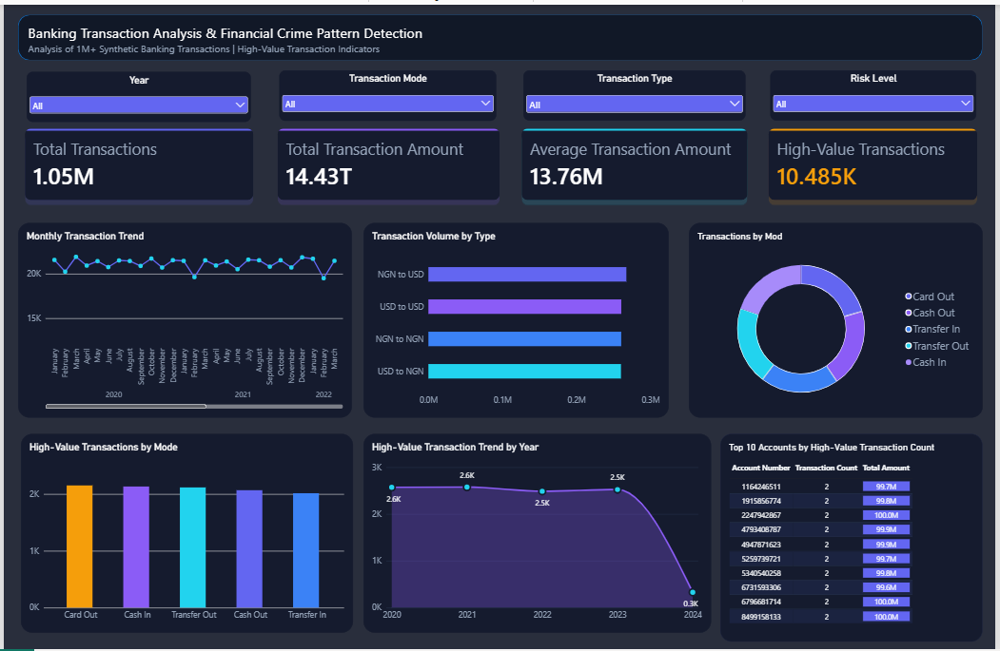

# Banking Transaction Analysis & Financial Crime Pattern Detection

An end-to-end data analytics project focused on exploring banking transaction patterns, analyzing transaction amounts, and identifying potentially unusual high-value activity using Python, SQL, and Power BI.

## Project Overview

This project analyzes over one million synthetic banking transaction records to understand transaction behavior across transaction modes, transaction types, time periods, and accounts. Statistical techniques are used to examine transaction amount distributions and flag high-value transactions for further investigation.

The analysis combines Python-based data cleaning and exploratory data analysis, MySQL queries, and an interactive Power BI dashboard to transform raw transaction data into meaningful insights.

## Objectives

- Analyze transaction volumes and transaction amounts.
- Compare transaction modes and transaction types.
- Perform data cleaning and exploratory data analysis.
- Apply statistical methods to investigate transaction amount distributions and outliers.
- Identify high-value transactions using a percentile-based threshold.
- Examine transaction trends over time and high-value activity across accounts.
- Present key metrics and findings through a Power BI dashboard.

## Tech Stack

- **Programming:** Python
- **Data Analysis:** Pandas, NumPy
- **Data Visualization:** Matplotlib, Seaborn
- **Database:** MySQL
- **Business Intelligence:** Power BI
- **Development Environment:** Jupyter Notebook

## Dataset

The project uses the synthetic **SFinDSet – Systematic Detection of FinCrimes** dataset from Kaggle.

The dataset includes transaction-level information such as:

- Transaction ID
- Account number and account name
- Transaction amount
- Transaction mode
- Transaction type
- Transaction date
- Transaction source and destination

**Dataset statistics**

| Metric | Value |
|---|---:|
| Original records | 1,048,575 |
| Duplicate records removed | 109 |
| Cleaned records | 1,048,466 |
| Missing values | None identified |
| Transaction date range | Jan 2020 – Feb 2024 |
| High-value transactions flagged | 10,485 |

## Project Workflow

### 1. Data Cleaning and Preparation

- Loaded the transaction dataset into Python using Pandas.
- Checked data types, missing values, and duplicate records.
- Removed 109 duplicate records.
- Converted transaction dates to an appropriate date-time format.
- Created date-based features for temporal analysis.
- Prepared a cleaned dataset for further analysis.

### 2. Exploratory Data Analysis

- Examined transaction amount distributions and summary statistics.
- Analyzed transaction counts and total amounts by transaction mode.
- Compared transaction types and their associated transaction volumes.
- Explored transaction patterns across years, months, days, and hours.
- Investigated account-level transaction activity.

### 3. Statistical Analysis and High-Value Identification

- Used percentiles to understand the distribution of transaction amounts.
- Applied the 99th-percentile transaction amount threshold to flag high-value transactions.
- Used the interquartile range (IQR) method to investigate statistical outliers.
- Compared high-value transaction activity across modes, years, and accounts.

The high-value flag is a rule-based analytical indicator, not a confirmed fraud label.

### 4. SQL Analysis Using MySQL

Used SQL queries to summarize and investigate transaction data, including:

- Total transaction counts and amounts.
- Transaction volume by mode and type.
- High-value transaction summaries.
- Year-wise transaction trends.
- Account-level high-value transaction activity.

SQL queries are available in the `sql/` folder.

### 5. Power BI Dashboard

Created an interactive dashboard to summarize transaction activity and support exploratory analysis.

**Key Performance Indicators (KPIs)**

- Total Transactions
- Total Transaction Amount
- Average Transaction Amount
- High-Value Transactions

**Visualizations**

- Monthly Transaction Trend
- Transactions by Mode
- Transaction Volume by Type
- High-Value Transactions by Mode
- High-Value Transaction Trend by Year
- Top 10 Accounts by High-Value Transaction Count

### Dashboard Preview



## Key Findings and Analysis

- The cleaned dataset contains **1,048,466 transaction records** after duplicate removal.
- **10,485 transactions** were flagged using the 99th-percentile amount threshold.
- Transaction modes and transaction types can be compared by transaction volume and aggregate amount.
- Time-based analysis helps explore changes in transaction activity across the available date range.
- Account-level analysis highlights accounts with comparatively high volumes of flagged transactions.

These are descriptive analytical findings. Further investigation and additional evidence would be required to determine whether any transaction represents financial crime.

## Repository Structure

```text
Banking-Transaction-Analysis/
├── dashboard/
│   └── dashboard_overview.png
├── notebooks/
│   └── banking_analysis.ipynb
├── powerbi/
│   └── banking_analysis_dashboard.pbix
├── sql/
│   └── banking_analysis.sql
├── .gitignore
└── README.md
```

*Note: Update the filenames above if your actual files use different names.*

## How to Explore the Project

1. Clone or download this repository.
2. Download the dataset from its original Kaggle source, subject to its terms of use.
3. Open the Jupyter Notebook in the `notebooks/` folder.
4. Review the SQL queries in the `sql/` folder.
5. Open the Power BI report in Power BI Desktop if the `.pbix` file is available.
6. Use the dashboard slicers to explore transaction activity by year, mode, type, and risk level.

Database connection settings may need to be configured for your local MySQL installation.

## Limitations

- The dataset contains synthetic transaction records.
- The analysis does not use confirmed fraud labels to validate detection performance.
- A high transaction amount or statistical outlier does not, by itself, establish suspicious or fraudulent activity.
- Transaction types include NGN and USD categories. Aggregate amounts across different currencies should not be interpreted as a single-currency total without currency-specific analysis.

## Future Improvements

- Add currency-specific transaction analysis.
- Explore additional behavioral indicators, such as transaction frequency and repeated transfer patterns.
- Extend account-level risk analysis.
- Publish an interactive Power BI report for portfolio viewing where appropriate.
- Validate potential risk indicators against labeled data if suitable data becomes available.

.
